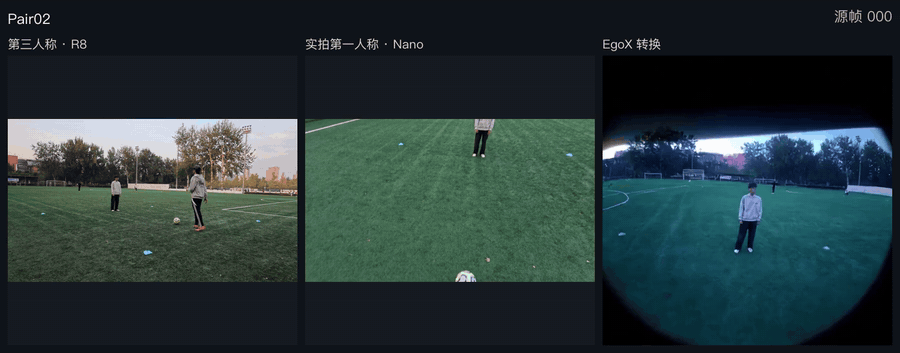
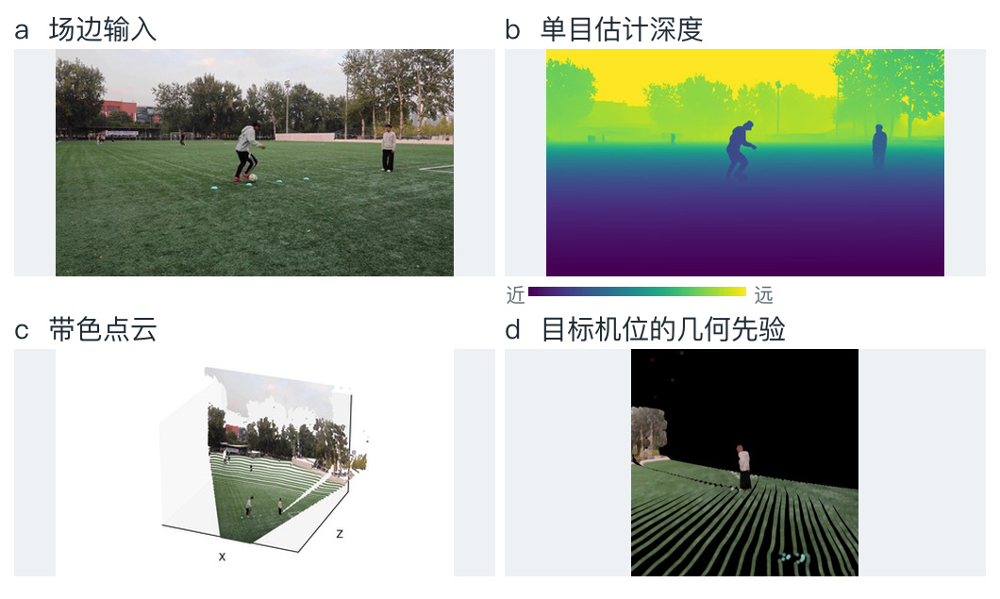

<h1 align="center">Football EgoX · 足球第一视角</h1>

<p align="center"><strong>从一台场边相机的录像，生成球员的第一人称画面。</strong></p>

<p align="center">
  <a href="https://cyclotr0nzxj.github.io/football-egox/#pair02">观看传球对照</a> ·
  <a href="https://cyclotr0nzxj.github.io/football-egox/">全部视频</a> ·
  <a href="https://cyclotr0nzxj.github.io/football-egox/report/week14_football_egox.pdf">实验报告</a> ·
  <a href="project/README.md">运行与复现</a>
</p>

<p align="center">
  <a href="https://cyclotr0nzxj.github.io/football-egox/#pair02"></a>
</p>

<p align="center">左为场边第三人称输入，中为头戴第一人称实拍，右为 EgoX 生成。头戴实拍仅用于同步对照和验证。</p>

## 四段对照

这组计算机视觉课程实验使用四段自采足球录像。每段 49 帧，按 25 fps 并列播放场边录像、头戴实拍和实验结果。

| 片段 | 展示结果 | 视频 |
| --- | --- | --- |
| 向队友传球 | EgoX 首版 | [播放](https://cyclotr0nzxj.github.io/football-egox/#pair02) · [MP4](https://cyclotr0nzxj.github.io/football-egox/appendix/videos/Pair02.mp4) |
| 沿标志盘带球 | EgoX 首版 | [播放](https://cyclotr0nzxj.github.io/football-egox/#pair04) · [MP4](https://cyclotr0nzxj.github.io/football-egox/appendix/videos/Pair04.mp4) |
| 低头看球 | 几何预览 | [播放](https://cyclotr0nzxj.github.io/football-egox/#pair01) · [MP4](https://cyclotr0nzxj.github.io/football-egox/appendix/videos/Pair01.mp4) |
| 跟球 | 几何预览 | [播放](https://cyclotr0nzxj.github.io/football-egox/#pair05) · [MP4](https://cyclotr0nzxj.github.io/football-egox/appendix/videos/Pair05.mp4) |

[视频附录](appendix/README.md)提供编号、同步源帧和核验清单。

## 转换方法

以场边录像为唯一视频输入。ViPE 估计逐帧深度，将图像反投影为带色点云。随后用场边画面中的头部标注定位虚拟相机，从目标机位渲染几何先验，再由 EgoX 生成第一人称画面。

<p align="center">
  
</p>

## 运行与复现

安装 Git LFS 后直接克隆。自采录像随工作区检出，EgoX 源码通过固定版本的子模块取得。

```sh
git lfs install
git clone --recurse-submodules https://github.com/cyclotr0nzxj/football-egox.git
cd football-egox/project
```

| 要做什么 | 从这里开始 |
| --- | --- |
| 重跑首版或调整虚拟机位 | [两段 EgoX 推理输入、配置与命令](project/experiments/week14/README.md) |
| 做 CPU 核验或查看素材 | [项目入口、自采录像与实验记录](project/README.md) |
| 修改报告或找到配图来源 | [LaTeX、编译命令与图源索引](report/README.md) |
| 复现 Harris/SIFT 课程实验 | [第 8 周源码、数据与步骤](project/submission/week08_harris_sift/README.md) |

重新生成需要 CUDA 环境和官方模型权重。首版使用的相机轨迹、深度和几何先验随仓库提供。

## 上游项目

[EgoX](https://github.com/DAVIAN-Robotics/EgoX) · [EgoX-EgoPriorRenderer](https://github.com/kdh8156/EgoX-EgoPriorRenderer) · [ViPE](https://github.com/nv-tlabs/vipe) · [Wan2.1 I2V](https://huggingface.co/Wan-AI/Wan2.1-I2V-14B-480P-Diffusers)
